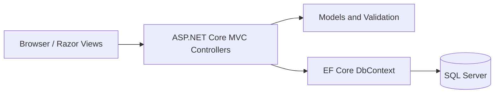

# ASP.NET Core User Registration & Login

  

A learning project implementing a registration and login workflow using **ASP.NET Core MVC**, **Entity Framework Core**, and **Microsoft SQL Server**. The existing source code, solution, and database migrations are preserved.

## Features and project layout

- MVC controllers and Razor views for registration, login, account editing, and deletion.
- Entity Framework Core SQL Server context and migrations.
- Custom date validation and session configuration.
- Bootstrap-based frontend assets.

```text
LoginSignup.sln
UserRegisteration/
  Controllers/       MVC request handlers
  Models/            Domain models, EF Core context, validation
  Migrations/        Database schema history
  Views/             Razor pages and layouts
  wwwroot/           CSS, JavaScript and images
  Program.cs         Application configuration
```

## Technology stack

| Layer | Technology |
| --- | --- |
| Runtime | .NET 8 / ASP.NET Core MVC |
| Language | C# |
| UI | Razor views, Bootstrap, CSS, JavaScript |
| Persistence | Entity Framework Core 8.0.8, SQL Server |
| Development | Visual Studio or .NET CLI |

## Run locally

1. Install the **.NET 8 SDK** and a SQL Server instance (SQL Server Express or Developer Edition).
2. Clone this repository and open `LoginSignup.sln`, or run the CLI from the repository root.
3. Configure your **own** database connection using an environment variable or local user secrets. The committed `appsettings.json` contains a machine-specific example and should not be relied upon on another computer.

   ```bash
   cd UserRegisteration
   dotnet user-secrets init
   dotnet user-secrets set "ConnectionStrings:UserContext" "Server=localhost;Database=UserRegisteration;Trusted_Connection=True;TrustServerCertificate=True"
   dotnet restore
   dotnet ef database update
   dotnet run
   ```

   Install `dotnet-ef` if the migration command is unavailable. Adjust the connection string to match your SQL Server configuration.

4. Open the local URL printed by ASP.NET Core.

## Architecture



## Security and maintenance notes

**Learning/demo project — not production-hardened.** Review authentication, password handling, input validation, CSRF protection, session security, and error logging before deployment. `Program.cs` currently enables EF Core sensitive-data logging; disable this outside controlled local debugging. Use user secrets or environment variables for credentials; never commit a real `.env` file.

## License

See the existing [LICENSE.txt](LICENSE.txt). Third-party libraries retain their respective licenses.
