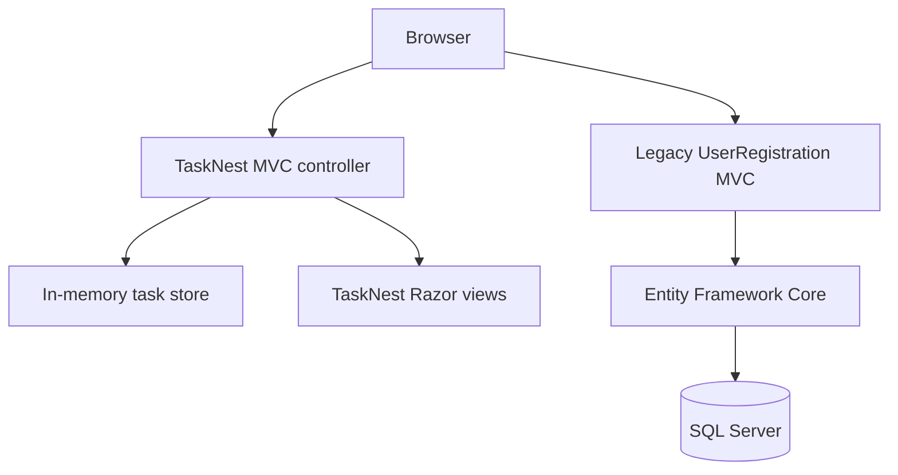

# TaskNest — ASP.NET Core MVC Task Manager

   

**TaskNest** is a responsive personal task management website built with C#, ASP.NET Core MVC, Razor views and custom CSS. The repository also retains an earlier **User Registration & Login** learning application, unchanged.

## TaskNest highlights

- Dashboard with total, active and completed task counters
- Create, edit, delete and complete tasks
- Search by title/description; filter by status and priority
- Category selection, due dates, server-side validation and CSRF protection
- Responsive UI with no external CSS/JS runtime dependency
- Self-contained in-memory demo data — **no database required**

## Quick start — TaskNest

Requires [.NET 8 SDK](https://dotnet.microsoft.com/download/dotnet/8.0).

```bash
git clone https://github.com/azaanmalik/DotNetLearning.git
cd DotNetLearning
dotnet run --project TaskNest/TaskNest.csproj
```

Open the localhost URL printed in the terminal. Data is in memory and resets after restarting the application. **This is a demo**, not a production multi-user task platform.

[TaskNest features, structure and architecture](TaskNest/README.md)

## Repository structure

```text
TaskNest/                New standalone task manager (ASP.NET Core MVC)
  Controllers/           Task routes and validation
  Models/                TaskItem
  Services/              Thread-safe in-memory task store
  Views/                 Razor dashboard, form and layout
  wwwroot/css/           Responsive design
  Program.cs             Application startup
  TaskNest.csproj        .NET 8 web project
UserRegisteration/       Original SQL Server login/registration demo (preserved)
LoginSignup.sln          Original solution (preserved)
docs/ARCHITECTURE.md    Overview of both projects
SECURITY.md             Security and deployment caveats
CONTRIBUTING.md         Contribution guidance
LICENSE.txt             MIT license
```

## Original registration/login project

The original application uses ASP.NET Core MVC, Entity Framework Core 8 and SQL Server. To run it, configure a local SQL Server connection and then:

```bash
dotnet restore LoginSignup.sln
dotnet run --project UserRegisteration/UserRegisteration.csproj
```

Its existing `appsettings.json` includes a machine-specific development connection string. Configure your own connection using ASP.NET Core user secrets or environment variables before running. See [security guidance](SECURITY.md); the legacy app is **not production hardened**.

## Architecture



## License

MIT — [LICENSE.txt](LICENSE.txt). Third-party assets retain their own terms.

## Verification notes

GitHub file presence and repository structure were checked. A successful runtime build or browser test should only be claimed after execution in a .NET environment. The TaskNest GitHub Actions workflow is configured to build the new application.
