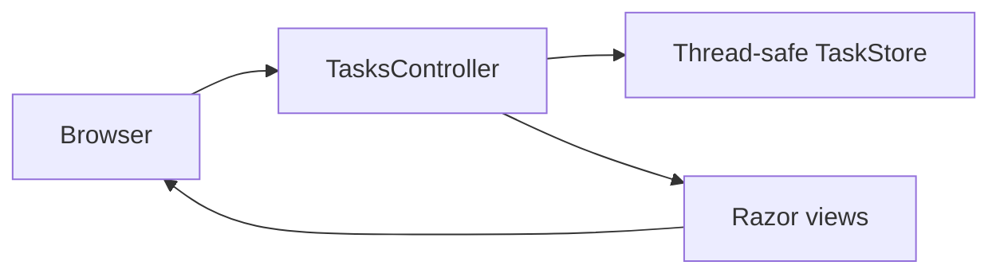

# TaskNest — ASP.NET Core MVC Task Manager

  

TaskNest is a responsive task management website built with **ASP.NET Core 8 MVC**, Razor views, C# and custom CSS. It runs independently of the existing `UserRegisteration` application in this repository.

## Features

- Dashboard with total, active and completed task counters
- Create and edit tasks with validation
- Mark tasks complete/incomplete and delete tasks
- Search by title/description, filter by status and priority
- Categories, priorities, optional due dates and responsive UI
- CSRF protection for form submissions and safe Razor output encoding

## Run locally

Prerequisite: [.NET 8 SDK](https://dotnet.microsoft.com/download/dotnet/8.0)

```bash
dotnet run --project TaskNest/TaskNest.csproj
```

Open the local URL printed in the terminal. The default route opens the dashboard.

**Data storage:** This demo uses a thread-safe in-memory store with three sample tasks. All changes reset when the application restarts. No SQL Server or API key is needed.

## Project structure

```text
TaskNest/
├── Controllers/TasksController.cs
├── Models/TaskItem.cs
├── Services/TaskStore.cs
├── Views/Shared/_Layout.cshtml
├── Views/Tasks/Index.cshtml
├── Views/Tasks/Form.cshtml
├── Views/_ViewImports.cshtml
├── Views/_ViewStart.cshtml
├── wwwroot/css/site.css
├── Program.cs
└── TaskNest.csproj
```

## Architecture



This is a portfolio/learning project, not a production multi-user service. Authentication, authorization and persistent storage are intentionally out of scope.

The original `LoginSignup.sln` and `UserRegisteration/` project remain unchanged.
