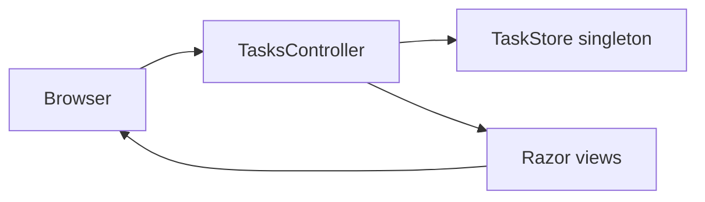
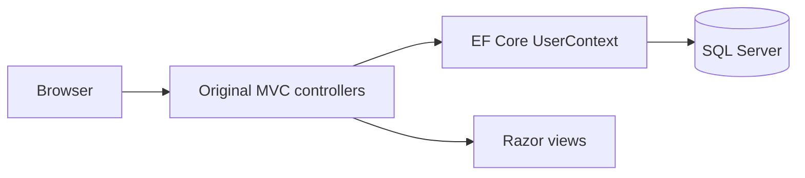

# Repository architecture

This repository contains **two independent ASP.NET Core MVC applications**. The original SQL Server registration app remains in place, while TaskNest adds a self-contained task manager.

## TaskNest (featured project)

- `TaskNest/Program.cs`: MVC services, routing, static files, HTTPS redirection.
- `TaskNest/Controllers/TasksController.cs`: task CRUD, status toggle, filters and validation.
- `TaskNest/Models/TaskItem.cs`: validated task model.
- `TaskNest/Services/TaskStore.cs`: synchronized in-memory store with sample records.
- `TaskNest/Views/`: Razor pages and reusable layout.
- `TaskNest/wwwroot/css/site.css`: responsive visual design.

TaskNest requires **.NET 8** and no database. Its data resets when the server restarts.

## Original UserRegisteration project

The original application targets .NET 8, uses EF Core SQL Server, and has existing migrations. Its authentication and credential handling require security review before any production deployment.

## Isolation and compatibility

The two apps have **separate project files and startup pipelines**. No original controllers, models, migrations or database schema were replaced by TaskNest. Start the desired app with `dotnet run --project <path-to-csproj>`.
