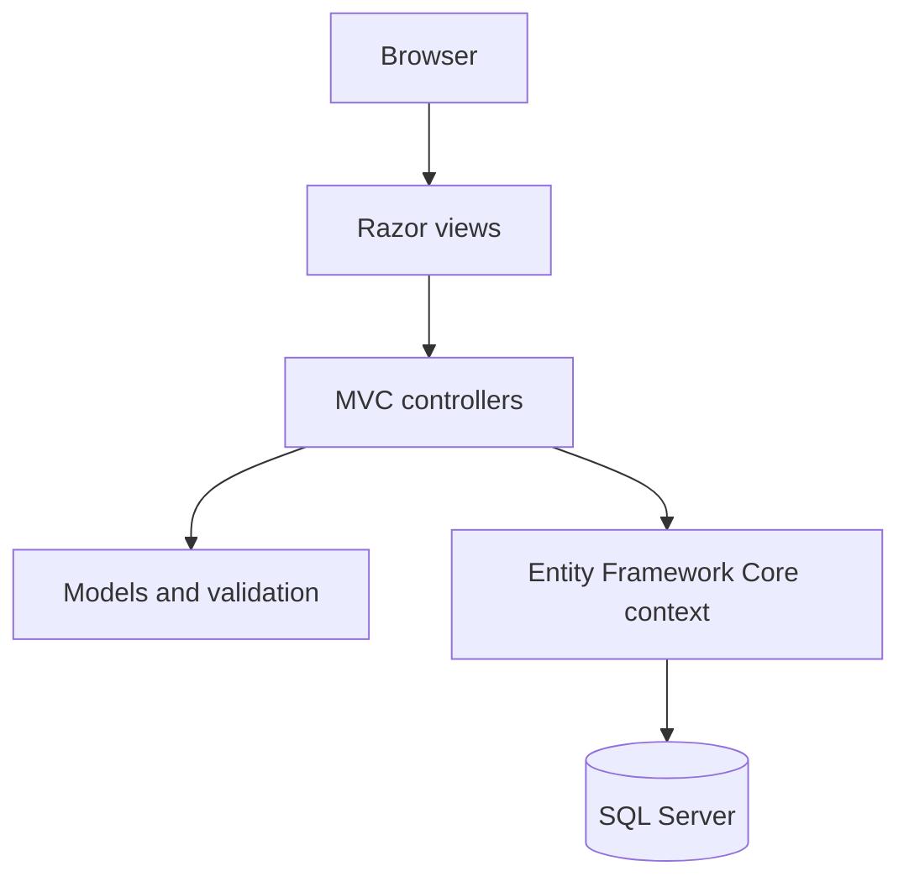

# Architecture overview

The solution is located at `LoginSignup.sln`. The ASP.NET Core project is `UserRegisteration/UserRegisteration.csproj` and targets .NET 8. Controllers handle HTTP requests, Razor views render pages, and EF Core manages database access and migrations.

This document describes the checked-in structure, not a claim that authentication or production security has been independently validated.
